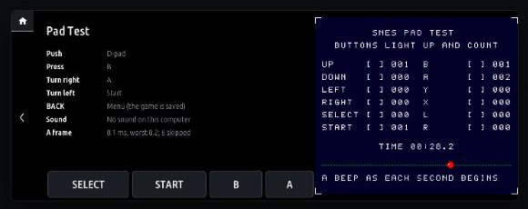

# SNES for iDrive 7

**Super Nintendo games on the BMW iDrive 7 (MGU) head unit itself.** The [Snes9x](https://github.com/libretro/snes9x2005) emulator runs inside an app on the head unit, built on the [idrive7-apps](https://github.com/cauliflowermossgrape/idrive7-apps) kit the way [NES for iDrive 7](https://github.com/clucraft/nes-idrive) is: the console's picture shown three times as big, pixel for pixel, played with an Xbox pad on a cable, sound on the car's speakers. For when you're parked.

> **Status: built and tested on a PC. Nothing of it has been on a car.** The app, its game loader and the package for the MGU Store exist; the tests pass on the Node.js the head unit runs; the app plays in the kit's emulator. Whether the head unit runs it fast enough is the open question this first version is made to answer: it measures itself and writes the answer into its log. See [What has run where](#what-has-run-where) and [What to try on the car](#what-to-try-on-the-car).

> **For non-commercial use only.** The emulator core is Snes9x, whose licence allows nothing else. See [Licence](#licence).

> **Your iDrive 7 head unit must be rooted to use this**, as for every app of the idrive7-apps kit. Rooting is done with the community tool [idrive7-8-ssh-root](https://github.com/cauliflowermossgrape/idrive7-8-ssh-root); it can wipe the head unit's coding, delete BMW Digital Key pairings and, at worst, brick the unit. The [NES project's README](https://github.com/clucraft/nes-idrive#rooting-your-head-unit) has what to know before you start. The emulator on a PC needs no root.



*Pad Test in the app, as the head unit's 1920 x 720 screen would show it (the kit's emulator on a PC).*

**It comes with one small free game, Pad Test,** written for it. Beyond that the app runs `.sfc` and `.smc` files you supply. This is an independent community project. It is not affiliated with or endorsed by BMW or Nintendo. All trademarks belong to their owners.

---

## What it does

### Games

- **Pad Test comes with the app:** it shows every button of the pad, a clock, a ball and a beep, to see at a glance how the head unit does ([`games/`](games) has its source).
- Your own `.sfc` and `.smc` files get to the app in four ways:
  - **From a phone.** *Add games from a phone* in the menu shows a QR code. The phone, on the same Wi-Fi as the car, opens the page behind it and you pick the files. This needs the [SNES game loader](loader), a small service installed beside the app.
  - **A USB stick,** in a folder named `snes` at its top. They are played from the stick, not copied. *The NES app never showed whether the head unit lets an app read a stick; neither has this one.*
  - **`roms/` in the app's data folder on the head unit** (`/var/opt/public/oap/oap_<uid>/data/roms/`; the app's log names the folder at each start).
  - **`app/roms/` on your PC.** The build for the kit's installer packs the folder into the app. Git ignores them, and the package the MGU Store installs never has them.
- **What is a game file:** an SNES ROM has no signature at its start, so the app looks for the cartridge's header where a LoROM, a HiROM and an ExHiROM game have it, behind a copier's 512 bytes (`.smc`) or not, and weighs it as Snes9x does. A wrong checksum does not rule a file out: translations and hacks have them. Up to 8 MB a game.
- **The core is snes9x2005** (Snes9x 1.43): the lightest of the Snes9x family and the least exact. It has the special chips (SuperFX, SA-1, DSP-1, DSP-2, DSP-4, C4, S-DD1, SPC7110, OBC1, S-RTC, Seta's); how well each game runs is not known here. One player.

### Controls

**A USB gamepad is how this is played.** An **Xbox One or Xbox Series pad on a cable**, plugged into the car's USB port, with the [SNES game loader](loader) installed. Its buttons are the SNES pad's twelve, **by where they are and not by their letters**: an SNES pad has A on the right and B at the bottom, an Xbox pad the other way round.

| Xbox pad | SNES pad |
|---|---|
| A (bottom), B (right), X (left), Y (top) | B, A, Y, X |
| LB, RB | L, R |
| Menu, View | Start, Select |
| D-pad, left stick | the D-pad |
| **both sticks pressed in together, or the Xbox button** | **leaves the game for the list of games** (no SNES button does: all twelve are the game's) |

The setting *Gamepad buttons* has it by the letters instead. On the games screen the pad's D-pad and A steer, LB and RB change tabs.

**The iDrive controller** gives one direction at a time, one held button and taps:

| | |
|---|---|
| Push up / right / down / left | D-pad, held while pushed |
| Press | B, held while pressed |
| Turn right, one click | a tap of A |
| Turn left, one click | a tap of Start |
| SELECT, START, B, A on the touchscreen | a tap of that button |
| BACK | the main menu; the game is saved |

That steers the menus and is enough for a slow game; for nearly every SNES game it is not. Press and the two turn directions can be given other buttons in the settings.

### The picture

- **256 x 224, three screen pixels to each of the console's,** beside a panel with the controls. A game that uses the console's 239 lines still fits the screen's 720.
- **High-resolution pictures** (512 wide, sometimes 448 lines: a few games' menus and text) are shown in the same place, each pixel one and a half of the screen's. Looked at in the emulator, that reads far better than blending them down to 256, so it is how the app starts; the setting has the other.
- **A frame that is not seen is not drawn.** When the app has to run several frames at once to keep the game's pace, it draws the last. With the setting *Picture* on its first choice it also draws only every second frame while what it does for a frame (the emulator, and handing the picture over) takes over half a frame's time, and says so in the log; the game and its sound keep full speed either way.

### Sound

A game's sound plays on the car's speakers, through the [SNES game loader](loader). It takes the place of what the head unit played before, the radio or a phone's music, for as long as a game runs. The setting *Sound chip* picks between the core's own sound emulation (quick; a little flat: Pad Test's 1000 Hz beep comes out at 994) and blargg's (truer; 0.1 to 0.2 ms more a frame on a PC), from the next game on.

### Saves

- **Leaving the game saves it:** BACK, MENU, a popup or call, driving off, the app closing. It is also saved every 30 seconds while you play.
- ***Continue*** and picking the game again carry on from there. ***Start over***, beside the game in the list, starts it from power-on.
- **A cartridge's battery memory** (the game's own save) is kept separately and survives a restart, and a change of the sound chip. A saved state belongs to the sound chip setting it was made with: after a change the game starts from its battery memory once.
- **A crash loses them.** When an app exits unexpectedly, the head unit empties its data folder, and uninstalls the app the second time. Keep your games on the PC too.

### Settings

| Setting | Choices (first: as it starts) |
|---|---|
| Parked only (pauses while driving) | on, off |
| Carry on where the game was left | on, off |
| USB gamepad (Xbox pad on a cable; needs the SNES game loader) | on, off |
| Gamepad buttons | by where they are, by their letters |
| Controller press | B, A, Y, X, Start |
| Controller turn right | A, B, Y, X, L, R, Start, Select, Nothing |
| Controller turn left | Start, Select, B, A, Y, X, L, R, Nothing |
| Touch buttons beside the picture | on, off |
| Sound on the car's speakers (needs the SNES game loader; in place of the radio) | on, off |
| Sound chip (from the next game on) | the quick one, the truer one |
| Picture | every frame, and every second one when too slow; every frame always; every second frame always |
| High-resolution pictures | as they are, shrunk |
| Add games over the Wi-Fi the car is on (home, phone hotspot) | on, off |
| Less sprite flicker | off, on |

They are the tab *Settings* of the games screen, and the menu's *Settings*, which opens the head unit's own screen of them, where a finger works on every row.

## How it works

```
 app/main.js            the screens (the idrive7-apps kit: menu, GPU renderer, settings), the 60 Hz pacing,
     │                  what is drawn, saving, the parked check, the frame time in the log
     ├─ app/library.js    the games (the app's pack, the data folder, a USB stick) and the saves
     ├─ app/tabs.js       the games screen: the list, Add games, the settings
     ├─ app/controls.js   iDrive controller and touch buttons -> the SNES pad
     ├─ app/pad.js        a USB gamepad's buttons, from the SNES game loader -> the SNES pad
     ├─ app/sound.js      each frame's sound -> the SNES game loader, which plays it (loader/snes-sound)
     ├─ app/caraudio.js   asks the head unit's audio manager to put that on the speakers
     │
 app/snes-core.js       runs the emulator: game in, pad in, one frame at a time, picture and sound out;
     │                  and says what is a game file
 app/snes.wasm, snes-plus.wasm   snes9x2005 + core/mgu_libretro.c, compiled to WebAssembly (core/build.js)
     │
 the kit's GPU renderer (mgu-renderd)  ──▶  the picture as a 256 x 224 image, drawn 3 x 3
```

Nearly all of it is the NES app with its names changed. What an SNES changes is the core and its two builds, the twelve-button pad and the way out of a game, the game-file check, the sound's rate, pictures that change size, and drawing less when a frame takes too long. [`core/README.md`](core/README.md) has the core's build and what it was checked against; [`bakeoff/README.md`](bakeoff/README.md) how the core was chosen; [`loader/README.md`](loader/README.md) the loader.

## What has run where

**All of this ran on a PC, on 2026-11-20. No head unit has run any of it.**

- **The tests** (`npm test`): 71 pass on Node 8.17 on Linux (WSL) as root, 70 as a user (one needs root), and 63 on Windows on Node 8.17 and on Node 24 (what needs Linux is skipped there). They cover the game-file check; both cores on a cartridge the test makes itself (picture, pad, save states, battery memory, frames not drawn, high resolution, the memory never growing); the controller and the tabs; the gamepad from its USB packets to the app, with a stand-in for the program that reads it; the games and saves on disk; Pad Test played in the core, every button, its clock, its beep; games from a phone through the loader with a stand-in for the firewall; the sound through the loader, and the real player resampling from 32040 samples a second; and the Store's package being this `app/`, with both licences in it and no game but Pad Test.
- **The cores** match native builds of the same sources frame for frame, picture and sound ([`core/README.md`](core/README.md)).
- **The app in the kit's emulator:** the menu, the three tabs, a game from the list, Pad Test with the keyboard as the iDrive controller (push, press, a click each way counted as they should), a 512 x 448 picture, a game sent to the loader's page over HTTP arriving in the list and a file that is no game refused with its reason on the screen. No gamepad was plugged in.
- **Sound:** not heard by anyone yet. Measured: Pad Test's beeps through the loader's real player come out 1.000 s apart at 994 Hz (the quick sound chip) and 1002 Hz (the truer one). `node tools/sound-try.js` leaves a `.wav` to listen to.
- **Speed on this PC** (a Ryzen 7 9800X3D, Node 8.17): 0.16 to 0.52 ms a frame for scenes without a special chip, 1.3 ms for a SuperFX demo; the NES app's core, 0.26 ms. Free test ROMs only: no commercial game has been measured.
- **A save:** making a state (529 KB) and writing it took 0.6 to 1.1 ms on this PC. The app does that every 30 seconds while a game runs, as the NES app does, and writes into its log what it took.

The NES app and its loader, which this is made from, have run on one car: the Store installed them, an Xbox One S pad played, a game came from a phone, and sound was heard. That says the same ways are open to this app. It does not say this app works there.

## What to try on the car

In this order: each step shows whether the next is worth taking. After any of them, the app's log has the numbers:

```
ssh -i <id_rsa> root@<address> "grep -e 'snes:' -e 'gamepad:' -e 'sound:' /var/opt/public/oap/oap_<uid>/data/clucraft_snes.log"
```

(`ls -d /var/opt/public/oap/oap_*/data/clucraft_snes.log` finds the folder.)

0. **Before anything, with the NES app as it is installed:** play Snake for a minute, then read `grep -e 'ms a frame' -e 'compiled in' .../clucraft_nes.log`. That app already logs its frame time and how long the head unit took to compile its emulator. Against 0.26 ms and 66 ms on this PC, that is how many times slower the head unit is, and it tells what to expect below.
1. **Install *SNES*** from the Store (source `clucraft/snes-idrive`). Does it install and open? The log's first lines: `snes app started`, and `snes: emulator compiled in ... ms`.
2. **Pad Test with the iDrive controller.** Its clock against a watch for a minute; the ball crossing evenly; the four corner marks on the screen; one press counts one B, one click right one A, one click left one Start. Then the log: `snes: 600 frames in 10.0 s, ... ms a frame (worst ...), drawn ..., not drawn ..., skipped ..., late ...; a call ... ms, with a picture ... ms`. **These are the numbers:** a frame of the emulator alone, and a whole call with the picture handed over. A call under 8 ms and nothing skipped: the head unit has room. "Every second one from now" in the log: it does not, for that game.
3. **Install *SNES game loader***, restart the head unit once. Plug in the Xbox pad. In Pad Test every button lights its own light: the pad's A lights B (by position). Both sticks pressed in, or the Xbox button, go back to the list.
4. **Sound, still in Pad Test:** a beep as each second begins. Is it there? Does it come with the digit, or after it, and by how much? Hold a button: how soon is the hum? Leave the game: what does the head unit play then?
5. **A game of your own from the phone** (*Add games*), an ordinary one first. Does it play at full speed with sound? The log's line for it.
6. **The setting *Sound chip* on "the truer one"**, the same game again: hear the difference, and read the difference in the log's milliseconds.
7. **A heavy game:** one with a SuperFX or SA-1 chip, and one that uses high resolution if you have one. The log says how far over the time they are, and whether drawing every second frame was enough.
8. **A USB stick** with a folder `snes`: the log's line `snes: USB sticks: ...` says whether the head unit lets an app look.

## Try it in the emulator

You need **Node.js 18+**, **Python 3** and **git**. No car, no head unit and no BMW software are needed.

```bash
git clone --recursive https://github.com/clucraft/snes-idrive.git
```

```bash
cd snes-idrive
```

```bash
npm run emu
```

Then open http://localhost:8077. *Pad Test* is there at once; for your own games, copy `.sfc` or `.smc` files into `app/roms/` (or into `roms/` at the top, which the emulator reads without a rebuild).

- **Starting a game:** the main menu's rows are the buttons in the side panel. *Games* opens the games screen, which is drawn; the keys below steer it.
- **Controls:** the arrow keys push the iDrive controller, `Enter` presses it, the mouse wheel and `[` `]` turn it, `Backspace` is BACK. A click on a drawn button is a tap.
- **Add games from a phone** works here as well: the emulator starts the SNES game loader beside the app (`--no-phone` leaves it out), without root and without touching a firewall.
- **A real gamepad:** `npm run emu -- --pad` reads a USB gamepad plugged into the PC as the head unit would. The pad must be free of its kernel driver; on Windows that means handing it to WSL. [`tools/pad-try.js`](tools/pad-try.js) says how.
- **Sound:** the emulator plays none. `node tools/sound-try.js [game]` writes what the car's sound device would get as a `.wav`.

`npm run setup` (also run by `emu`) applies [`patches/idrive7-apps`](patches/idrive7-apps) to the kit (the emulator on Windows; the patch [boostline-idrive](https://github.com/clucraft/boostline-idrive) carries), links `app/` into the kit as `apps/clucraft_snes`, and writes a clearly marked **placeholder** for BMW's SDK, which the kit's build expects and the emulator never loads.

### Tests

```bash
npm test
```

```bash
npm run test:node8
```

Both run without a game of yours, a browser or the kit. `test:node8` runs them on Node 8.17.0, as the head unit does; it downloads that Node release once from nodejs.org and checks it against the release's checksums.

## On a car

From the [MGU Store](https://github.com/robertnisipeanu/mgu-store): Settings → **Add source**, `clucraft/snes-idrive`; install *SNES*, then *SNES game loader*, and restart the head unit once. The Store installs the package kept in [`store/`](store) (1.2 MB, with Pad Test and both builds of the core), adds BMW's SDK to it on the head unit, and installs the controller gate (`mgu-inputgate`) first when it is missing. A renderer has to be installed (the Store's own or the kit's).

It installs beside the NES app and its loader: every name is its own (`clucraft_snes`, `clucraft-snes-loader`, port 8494, log tag `OACA`).

With the kit's installer instead: BMW's SDK from your own head unit in `vendor/idrive7-apps/oap-sdk`, then `npm run build:car`; the [NES project's README](https://github.com/clucraft/nes-idrive#with-the-kits-installer) has the steps, which are the same. The loader installs through the Store only.

**What the app declares to the head unit** (the kit's defaults but for the disk): 128 MB of disk for its games and saves, a memory threshold of 192 MB, a CPU limit of 60. What the head unit does at those limits is not known. The loader lets the phone's folder hold 96 MB, a game 8 MB.

### Publishing a new version to the Store

The Store installs what is committed in `store/`, not `app/`:

1. Raise `version` in `app/app.json`.
2. `npm run build:store` builds the app with the kit and writes `store/clucraft_snes@<version>.tgz`, `store/app.json` and `store/icon.png`. It leaves BMW's SDK out of the package, and every game but the one in `app/games/`.
3. `npm test` fails if `store/` is not the `app/` beside it.
4. Commit `store/` with the change and push.

The loader is installed as it is in `loader/`. A change to what it installs needs a new `version` in `loader/component.json` and `loader/service.js`.

## Known gaps

- **Everything on a car.**
- **Speed** for commercial games, and for games with a SuperFX or SA-1 chip above all.
- **Gamepads other than an Xbox One or Series pad on a cable,** and a second player.
- **A PAL game** runs at its 50 frames a second on the 60 Hz screen, so it scrolls less smoothly.
- **Accuracy:** snes9x2005 is Snes9x as it was in 2004. Some games that run on a current emulator will not run right here.
- **iDrive 8:** not tested.

## Repository layout

```
app/                  the head-unit app: app.json, main.js, snes-core.js, controls.js, library.js, tabs.js,
                      phone.js and qr.js (Add games from a phone), pad.js (a USB gamepad), sound.js and
                      caraudio.js, snes.wasm and snes-plus.wasm (the emulator, built by core/build.js),
                      games/ (the game that comes with it), roms/ (your games), LICENSE and NOTICE
bakeoff/              how the core was chosen: the candidates built and measured, and the tools for it
core/                 the emulator's build: mgu_libretro.c (a libretro frontend for WebAssembly), build.js
docs/                 screenshots
games/                the source of Pad Test, and its build (cc65)
loader/               the SNES game loader: the page for games from a phone, the gamepad's reader
                      (snes-usbpipe), the sound's player (snes-sound); src/ has the two programs' source (Go)
patches/idrive7-apps/ the emulator on Windows, applied by tools/setup.js
mgu-repo.json         what the MGU Store reads
store/                the package the MGU Store installs, written by tools/build-store.js
test/run.js           the tests; fake-nft.js, fake-usbpipe.js and fake-sound.js stand in for the firewall
                      program, a gamepad and the program that plays sound
tools/                setup.js, emu.js, build-car.js, build-store.js, node8.js, licenses.js, loader-dev.js,
                      build-usbpipe.js, build-sound.js, pad-try.js, sound-try.js, cc65.js, tar.js, prebuilt.js
vendor/idrive7-apps   submodule: the MGU app kit, emulator and installer
vendor/snes9x2005     submodule: the core's source, unchanged, at the commit the .wasm files are built from
```

## Licence

**The app is for non-commercial use only.** It may be used, copied, changed and passed on free of charge; it may not be sold, bundled with something that is sold, or used to promote a commercial product. [`NOTICE`](NOTICE) says what is whose.

- **The emulator core** (`app/snes.wasm`, `app/snes-plus.wasm`; `vendor/snes9x2005`) is under its own licence file, [`LICENSE.snes9x2005`](LICENSE.snes9x2005): Snes9x's licence, which is where "non-commercial" comes from, and which asks that it and the copyright notice go with every copy and derived work. That file also carries notices under the GPL (version 2 or later) for the parts that come from the DS port NDSSFC and from ZSNES, and the MIT licence for libretro's own part.
- **Everything written for this project** (the app's code, the frontend `core/mgu_libretro.c`, the loader and its two programs, Pad Test, the tools and tests) is under the MIT licence: [`LICENSE`](LICENSE). Much of it comes from NES for iDrive 7, by the same author.
- `app/caraudio.js` is M850i-amn's (MIT). `core/libretro.h` is libretro's (MIT). `loader/snes-sound` has [purego](https://github.com/ebitengine/purego) in it (Apache-2.0, `loader/LICENSE.purego`).
- The submodules keep their own licences. The idrive7-apps kit is MIT; its GPU renderer and the emulator's draw engine are GPL-3.0-or-later and run as their own programs.
- The package in `store/` carries both licence texts (its `javascript/LICENSE`) and `NOTICE`.
- BMW's app SDK is BMW's. It is not in this repository, nor in the package in `store/`, and may not be published.
- No game but Pad Test is in this repository, and none may be added to it.
