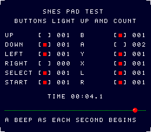

# The game that comes with the app

One small SNES cartridge, written for this repository so the app can be tried without a game of one's own. It is the only game in it. MIT, as this project's own files are.



**Pad Test** (`src/pad_test.s`) shows what the game gets from the pad, and what the head unit makes of the picture and the sound:

| | |
|---|---|
| The twelve buttons | each lights while it is held and counts its presses |
| The clock | counts 60 frames to the second: held against a watch it shows whether the game runs at full speed |
| The ball | crosses the screen one pixel a frame: it shows whether every frame is drawn, and evenly |
| The beep | a tenth of a second at 1000 Hz as each second begins on the clock: against the clock's digit it shows how far the sound trails the picture |
| The hum | 500 Hz while any button is held: against the thumb it shows how far the sound trails the pad |
| The corner marks | one in each corner of the picture: all four on the screen, and the whole picture is |

On the car it is the first thing to open. One press of the iDrive controller should count one B, one click to the right one A, one click to the left one Start (the settings can change which). With a gamepad every button lights its own light, by where it is on the pad: the Xbox pad's A is B here.

## Building

```bash
npm run build:games
```

This needs [cc65](https://cc65.github.io)'s assembler and linker (`ca65` and `ld65`; `apt install cc65`, `brew install cc65`) and Node.js. On a computer without them, `node tools/cc65.js` builds the two from cc65's source into the git-ignored `.cache/` with zig, the compiler the core is built with. It writes `app/games/Pad_Test.sfc`. That file is committed, so the app builds without cc65. A build gives the same bytes each time.

## Files

```
src/pad_test.s   Pad Test: 65816 code for the console, and the sound chip's small program as its bytes
                 (cc65 has no SPC700 assembler)
src/lorom.cfg    the cartridge's layout for the linker: LoROM, 128 KB, no chip, no battery
mkchr.js         the tiles: a 5 x 7 letter set and a few pictures, drawn in the file itself
build.js         builds it into app/games/, and signs the header with the cartridge's checksum
```

What has run, on a PC (2026-11-20): the tests play it in both of the app's cores (`test/run.js`: every button lights its own light and no other and counts once, 600 frames are ten seconds on its clock, the ball goes a pixel a frame, a beep begins every 60 frames and is 1000 Hz, the hum is 500 Hz), and it was played in the app in the kit's emulator with the keyboard as the iDrive controller. It has not run on a console, on another emulator, or on a car.
